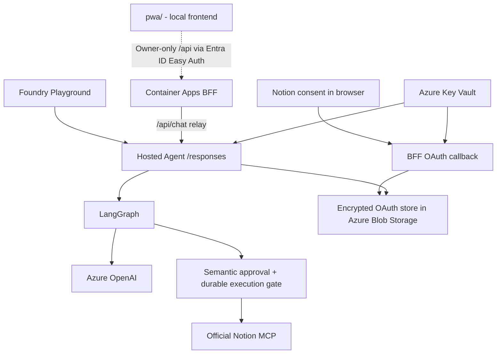

<div align="center">

✦ &nbsp; · &nbsp; ✧ &nbsp; · &nbsp; ✦ &nbsp; · &nbsp; ✧ &nbsp; · &nbsp; ✦


✧ &nbsp; · &nbsp; ✦ &nbsp; · &nbsp; ✧ &nbsp; · &nbsp; ✦ &nbsp; · &nbsp; ✧

# Savant Azurian 2

**An Azure-hosted personal AI agent built with Python, LangGraph, and Microsoft Foundry.**

[](https://github.com/boussecsou/savant-azurian/actions/workflows/ci.yml)
[](pyproject.toml)
[](src/savant/graph.py)

</div>

**Monorepo:** Hosted Agent, BFF and web interface ([`pwa/`](pwa/)) live in this repository.

Savant Azurian 2 is a single-owner AI assistant designed for natural conversation, secure tool use, and a future voice-first interface. This repository contains the **agent runtime**, the **Notion OAuth backend-for-frontend (BFF)**, automated tests, infrastructure configuration, and delivery workflows.

The user-facing Progressive Web App lives in **[`pwa/`](pwa/)** (React + Vite). It started in a separate repository and now lives here, so the BFF/PWA contract changes in a single pull request. The PWA has no Azure delivery: it is validated by CI and runs on the owner's machine.

## System overview

| Layer | Service / technology | Responsibility |
| --- | --- | --- |
| Web interface | [`pwa/`](pwa/) · runs locally, calls the BFF *(Azure hosting undecided)* | Chat, voice interaction, projects, documents, and connection controls |
| Backend-for-frontend | Azure Container Apps · FastAPI | Notion OAuth callback; future owner-authenticated PWA API |
| AI runtime | Microsoft Foundry Hosted Agent · LangGraph | Conversation orchestration, model calls, tools, and approval flow |
| Model access | Azure OpenAI · Microsoft Entra ID | Model inference without embedded API keys |
| Notion tools | Official Notion MCP | Dynamic tool discovery, read operations, and separately approved mutations |
| Credentials | Azure Blob Storage · Azure Key Vault | Shared encrypted Notion OAuth token storage and encryption key |

### Request and authorization flow



**Two separate permissions matter:** Notion OAuth authorizes access to a workspace; Savant's conversational approval authorizes a particular potentially mutating tool operation. One does not replace the other.

## Implementation status

The Hosted Agent and the OAuth/PWA backend (BFF) are deployed. Real Foundry, Notion and SSH tests have exercised reads, approved writes with independent readback, refusals without side effects, conversation continuity and replay protection. The voice pipeline (speech-to-text, agent, text-to-speech) has been validated end to end; documents per project use Azure AI Search.

| Capability | Where it is described |
| --- | --- |
| Notion reads and approved writes | [Notion live validation](docs/notion-live-validation-2026-10-25.md) |
| SSH tool with a semantic command judge | [SSH tool](docs/ssh-tool.md), [live validation](docs/ssh-live-validation-2026-11-02.md) |
| Voice | [Voice contract](docs/voice-contract.md), [live validation](docs/voice-live-validation-2026-11-03.md) |
| Documents per project (Azure AI Search) | [Search documents](docs/search-documents.md) |
| Projects and sessions (Cosmos DB) | [Workspace](docs/workspace-cosmos.md) |
| Tool reliability and observability | [Reliability](docs/tool-reliability.md), [Observability](docs/observability.md) |

Not established as production features: OAuth token revocation and reconnection under real conditions, and Azure hosting of the web interface (it runs on the owner's machine). Successful CI or a `/readiness` response is not evidence of a complete OAuth or tool workflow. The standard test suite uses test doubles and never touches Azure.

## Repository structure

```text
savant-azurian/
├── main.py                    # Hosted Agent entry point
├── azure.yaml                 # Foundry Hosted Agent deployment configuration
├── src/savant/
│   ├── agent.py               # Model and ResponsesHostServer setup
│   ├── graph.py               # LangGraph orchestration
│   ├── config.py              # Environment configuration and validation
│   ├── identity.py            # Shared agent identity instructions
│   ├── semantic_approval.py   # Independent semantic consent judge
│   ├── semantic_ledger.py     # Durable, single-use operation authorization
│   ├── reliability.py         # Tool timeouts, retries, argument validation
│   ├── documents.py           # Per-project document search (Azure AI Search)
│   ├── notion_oauth.py        # Direct OAuth and encrypted credential handling
│   ├── oauth_callback.py      # BFF (FastAPI): OAuth callback and PWA routes
│   ├── bff_*.py, workspace*.py, document_library.py   # BFF API, projects/sessions, documents
│   └── tools/                 # Notion, Toolbox, SSH tools and their policies
├── bff/                       # BFF publication and release helpers
├── scripts/                   # Release planning, smoke tests, evaluations
├── tests/                     # Unit, integration-style, and security tests
├── evals/                     # Evaluation datasets (consent judge, SSH judge, tool calls)
├── docs/                      # Architecture notes and validation reports (see docs/README.md)
├── pwa/                       # Web interface (React + Vite PWA, CI only, runs locally)
├── .github/
│   ├── components.json        # Agent/BFF ownership rules and the CI-only PWA check
│   ├── workflows/             # CI, agent CD, and BFF image publication
│   └── rulesets/              # Branch ruleset template for main
├── Dockerfile.bff             # Standalone BFF container image
├── .env.example               # Local configuration template
├── pyproject.toml             # Package metadata and dependencies
└── uv.lock                    # Locked Python dependencies
```

## Local development

### Requirements

- **Python 3.13**
- **[uv](https://docs.astral.sh/uv/)**
- Access to an existing **Azure OpenAI deployment** and an authorized Azure identity for live model calls
- **Docker** only when building or testing the BFF container locally

### Install and run tests

```bash
git clone https://github.com/boussecsou/savant-azurian.git
cd savant-azurian
uv sync --locked --group dev
uv run --locked pytest
```

The standard test suite uses test doubles for external services; running it does not provision Azure resources or grant Notion access.

### Start the agent locally

```bash
cp .env.example .env
```

In `.env`, configure at least:

```dotenv
AZURE_OPENAI_BASE_URL=https://YOUR-RESOURCE.openai.azure.com/openai/v1/
AZURE_AI_MODEL_DEPLOYMENT_NAME=YOUR_MODEL_DEPLOYMENT_NAME
PORT=8088
NOTION_MCP_ENABLED=false
TOOLBOX_ENDPOINT=
```

Then, with an already authorized Azure session:

```bash
uv run --locked python main.py
```

The local Responses server listens on port **8088** by default. Live model calls may incur Azure charges. Never commit `.env` or OAuth tokens.

For direct Notion OAuth, identity configuration, the standalone callback, and the shared encrypted store, use the [direct OAuth guide](docs/notion-chat-oauth.md). Local defaults intentionally differ from the Notion-enabled cloud settings in `azure.yaml`.

### Test the BFF container

```bash
docker build -f Dockerfile.bff -t sa2-bff:ci .
python3 scripts/smoke_test_bff.py sa2-bff:ci
```

The BFF listens on port **8090** and exposes `/readiness`. This smoke test uses synthetic configuration; it does not authorize a real Notion workspace.

## Security principles

- **Single-owner MVP:** the hosted runtime binds sensitive operations to a trusted owner identity. An arbitrary browser-supplied user ID must never grant access.
- **Managed identities and least privilege:** Azure resources use scoped RBAC rather than hard-coded credentials.
- **Encrypted OAuth storage:** the Hosted Agent and BFF share protected token storage and the encryption key; PKCE and state validation protect the authorization flow.
- **Explicit mutation approval:** the semantic classifier returns approval, rejection, or clarification; the execution layer separately checks operation scope, conversation, owner, expiry, and replay protection.
- **Conservative failure behavior:** missing identity, unavailable credentials, invalid approval output, or uncertain results do not silently authorize writes.
- **Protected logging:** callback application logs avoid exposing OAuth authorization codes, tokens, and raw sensitive query data.

A successful finite evaluation set does not guarantee perfect semantic classification or exactly-once completion at the remote Notion service.

## CI/CD and deployment boundaries

GitHub Actions validates the repository and maintains separate delivery paths for the **Hosted Agent** and the **BFF**. Component ownership is defined in [`.github/components.json`](.github/components.json).

| Workflow | Purpose |
| --- | --- |
| [CI](.github/workflows/ci.yml) | Run locked Python tests and relevant component checks |
| [Hosted Agent CD](.github/workflows/cd.yml) | Deploy an eligible, CI-validated agent revision with Azure OIDC; smoke-test the deployed runtime |
| [Publish BFF](.github/workflows/publish-bff.yml) | Build, verify, and publish immutable BFF images to ACR when eligible |

**Publishing a BFF image to Azure Container Registry does not update the running Azure Container App.** BFF rollout is a distinct operational step. The PWA lives in `pwa/`: it is declared in `.github/components.json` as non-runtime with a CI-only check, so PWA changes run the Node job and never deploy the agent or publish the BFF.

Cloud deployments require the appropriate existing Azure resources and permissions. This README does not instruct automated provisioning.

## Documentation

| Document | Contents |
| --- | --- |
| [Documentation index](docs/README.md) | Every document, grouped by topic |
| [Design record](docs/design/README.md) | Specifications, design documents and [22 architecture decision records](docs/adr/README.md) |
| [Configuration reference](docs/configuration.md) | Every variable and secret, and where each one lives |
| [Notion live validation](docs/notion-live-validation-2026-10-25.md) | Real endpoint tests, regression findings, and unverified cases |
| [Conversational approval](docs/notion-semantic-approval.md) | Dynamic Notion tools and durable authorization design |
| [Direct Notion OAuth](docs/notion-chat-oauth.md) | Browser consent, callback, encrypted store, and resumption |
| [Local Notion setup](docs/notion-local.md) | Local MCP configuration |
| [CI design](docs/ci-workflow.md) | CI gates and component testing |
| [Agent CD design](docs/cd-workflow.md) | Hosted Agent release procedure |
| [BFF publishing](docs/publish-bff-workflow.md) | ACR publication and immutable image handling |
| [Component-based delivery](docs/component-cicd.md) | Change classification, release checkpoints, and independence |
| [Development conventions](AGENTS.md) | Repository engineering rules |

## Web interface (`pwa/`)

```bash
cd pwa
npm ci
npm test
npm run build
```

See [`pwa/README.md`](pwa/README.md). The frontend communicates with the **BFF**, never directly with privileged agent credentials or Notion secrets.

---

**Savant Azurian 2** is an evolving engineering project. Feature descriptions distinguish implemented behavior from planned architecture; see the linked validation reports for current evidence.

## Contributing, security and license

- [CONTRIBUTING.md](CONTRIBUTING.md): setup, rules that matter, pull requests.
- [SECURITY.md](SECURITY.md): how to report a vulnerability privately.
- Licensed under the [MIT License](LICENSE) (the `pwa/` folder keeps its own Apache-2.0 license, see [`pwa/LICENSE`](pwa/LICENSE)).

This is a personal project built around one owner's Azure subscription: reading, reuse and feedback are welcome, but running it for real needs your own Azure resources.
