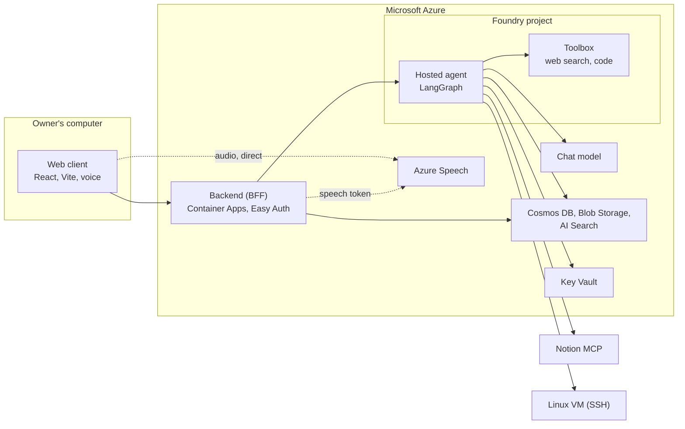

<div align="center">

✦ &nbsp; · &nbsp; ✧ &nbsp; · &nbsp; ✦ &nbsp; · &nbsp; ✧ &nbsp; · &nbsp; ✦


✧ &nbsp; · &nbsp; ✦ &nbsp; · &nbsp; ✧ &nbsp; · &nbsp; ✦ &nbsp; · &nbsp; ✧

# Savant Azurian

**A voice-first personal AI agent on Microsoft Azure, built so that it can act on your behalf and still ask first.**

[](https://github.com/boussecsou/savant-azurian/actions/workflows/ci.yml)
[](LICENSE)
[](pyproject.toml)
[](src/savant/graph.py)
[](docs/design/sdd-002-architecture-and-azure-infrastructure.md)

</div>

Savant Azurian is a single-owner assistant you talk to or type to. It reads and writes your Notion workspace, runs commands on a Linux VM, searches your project documents and the web, and answers by voice. The interesting part is what happens *before* it acts: every change goes through independent checks, so a confused or manipulated model cannot do damage on its own.

It is a complete system, not a demo: a LangGraph agent on a Foundry hosted agent, a FastAPI backend on Azure Container Apps, a React web client with a voice interface, infrastructure as code, and CI/CD that delivers each component independently.

## What makes it different

| | |
| --- | --- |
| **Two independent authorization layers** | OAuth authorizes a Notion workspace. A separate semantic judge, a single-use encrypted ledger and a server-written question authorize *one precise operation*. Neither replaces the other. [ADR-0017](docs/adr/0017-two-layer-authorization-for-notion-writes.md) |
| **A judge for every shell command** | A second model call returns `RUN`, `CONFIRM` or `REFUSE`; a confirmed command runs only on a later user turn, once, with the same fingerprint. Measured in pass^k. [ADR-0018](docs/adr/0018-ssh-tool-with-a-semantic-command-judge.md) |
| **Outside content is data** | Web pages, Notion pages and tool results are marked untrusted; the real locks are the judges, not the prompt. [ADR-0019](docs/adr/0019-external-content-is-data.md) |
| **No keys anywhere** | Entra ID and managed identities for every service, three secrets in Key Vault, and OIDC for CI. [ADR-0020](docs/adr/0020-keyless-access-with-entra-and-key-vault.md) |
| **Per-project retrieval** | Azure AI Search with the project filter imposed by the server, never chosen by the model. [ADR-0021](docs/adr/0021-per-project-document-retrieval.md) |
| **Honest by construction** | Fail closed, bounded tool calls, and an interface that shows only what exists. [ADR-0022](docs/adr/0022-bounded-tool-execution.md), [ADR-0013](docs/adr/0013-interface-shows-only-what-exists.md) |
| **Decisions on record** | 22 architecture decision records, 5 design documents and 2 specifications. [Design record](docs/design/README.md) |

## Architecture



**Two separate permissions matter.** Notion OAuth authorizes access to a workspace; Savant's conversational approval authorizes a particular, potentially mutating operation. One does not replace the other.

## Try it in five minutes, without Azure

You need [uv](https://docs.astral.sh/uv/), Node 22 and, optionally, [just](https://just.systems). Everything here runs offline against test doubles and a canned mock backend.

```bash
git clone https://github.com/boussecsou/savant-azurian.git
cd savant-azurian

just setup          # or: uv sync --locked --group dev && (cd pwa && npm ci)
just check          # lint, documentation check, Python tests, web tests and build

cd pwa && npm run dev:mock   # the web client on http://localhost:5173 with canned replies
```

Prefer a ready-made environment? Open the repository in a **dev container** (`.devcontainer/`): Python, Node, `az`, `azd`, `gh` and `uv` are installed for you.

## Run the agent locally

You need an Azure OpenAI deployment and an authorized Azure session. Live model calls may incur Azure charges.

```bash
cp .env.example .env     # set AZURE_OPENAI_BASE_URL and AZURE_AI_MODEL_DEPLOYMENT_NAME
uv run --locked python main.py        # the Responses server on :8088
```

Every setting is described in the [configuration reference](docs/configuration.md). A test keeps that page and `.env.example` in step with the code. For Notion OAuth, see the [direct OAuth guide](docs/notion-chat-oauth.md).

## Deploy your own copy

The infrastructure is Bicep, deployed with the Azure Developer CLI; secrets go straight to Key Vault and every personal value comes from your own `azd` environment, so nothing personal lives in the repository.

```bash
azd auth login
azd env new savant-dev
azd provision --preview     # see what would be created, change nothing
```

The [deployment guide](docs/deployment.md) walks through every step (about an hour the first time), with the role matrix, troubleshooting, costs and teardown. **It has not yet been validated against a real subscription**: see [project status](docs/status.md).

## Repository layout

```text
savant-azurian/
├── main.py                    # Hosted agent entry point
├── azure.yaml                 # azd configuration: references ${VAR} only, nothing personal
├── src/savant/                # The package: agent, graph, policies, BFF, retrieval
│   └── tools/                 # Notion, Toolbox and SSH tools and their policies
├── pwa/                       # Web client (React + Vite). Runs locally; validated by CI only
├── infra/                     # Bicep: main.bicep, main.bicepparam and one module per concern
├── scripts/                   # Release planning, smoke tests, evaluations, docs check
│   └── setup/                 # Secrets, roles and GitHub variables (dry run by default)
├── tests/  evals/             # Unit and security tests; evaluation datasets for the judges
├── docs/                      # Guides, reference, design record (specs, SDDs, ADRs)
├── .github/                   # Workflows, component registry, templates, ruleset
├── justfile  .devcontainer/   # Common tasks; a ready-made development environment
└── Dockerfile.bff             # The backend image
```

## Engineering practices

- **CI on every change:** locked dependencies, `ruff`, the Python suite (no test touches Azure), a documentation check, a secrets scan of the whole history, the backend image build and smoke test, and the web client's tests and build.
- **Component-aware delivery:** the agent and the backend are delivered independently from one registry of ownership; publishing an image does not roll it out. [SDD-004](docs/design/sdd-004-continuous-integration-and-delivery.md)
- **Everything pinned:** actions by commit SHA, Python by `uv.lock`, a generated `requirements.txt` that CI keeps in step.
- **Measured, not assumed:** the consent judge and the command judge have evaluation datasets scored in pass^k on the production model.
- **Documented and checked:** every setting has a row in one table, every decision an ADR, and links, anchors and ADR format are verified in CI.
- **Conventional Commits**, small pull requests, squash merges. See [CONTRIBUTING.md](CONTRIBUTING.md).

## Documentation

| Document | Contents |
| --- | --- |
| [Documentation index](docs/README.md) | Every document, grouped by topic |
| [User guide](docs/user-guide.md) | Using the web client: chat, voice, projects, documents, settings |
| [Deployment guide](docs/deployment.md) | Create your own Azure environment with Bicep and `azd` |
| [Configuration reference](docs/configuration.md) | Every variable and secret, and where each one lives |
| [Design record](docs/design/README.md) | Specifications, design documents and [22 architecture decision records](docs/adr/README.md) |
| [Project status](docs/status.md) | What is delivered, what is validated and what is not |
| [Development conventions](AGENTS.md) | Repository engineering rules |

## Project status

The agent, the backend and the web client are built and tested, and the real flows (Notion reads and approved writes, SSH, the voice pipeline) were validated against live services. The [project status](docs/status.md) says exactly what is validated, what is only tested with doubles, and what is not done: the infrastructure template has not met a real subscription, Gmail was not built, and retrieval over past sessions was designed and deferred. A green CI proves neither OAuth nor tools under real conditions.

## Contributing, security and license

- [CONTRIBUTING.md](CONTRIBUTING.md): setup, the rules that matter, pull requests.
- [SECURITY.md](SECURITY.md): how to report a vulnerability privately. [CODE_OF_CONDUCT.md](CODE_OF_CONDUCT.md).
- Licensed under the [MIT License](LICENSE). The `pwa/` folder keeps its own [Apache-2.0 license](pwa/LICENSE).

This is a personal project built around one owner's Azure subscription. Reading, reuse and feedback are welcome; running it for real needs your own Azure resources.
