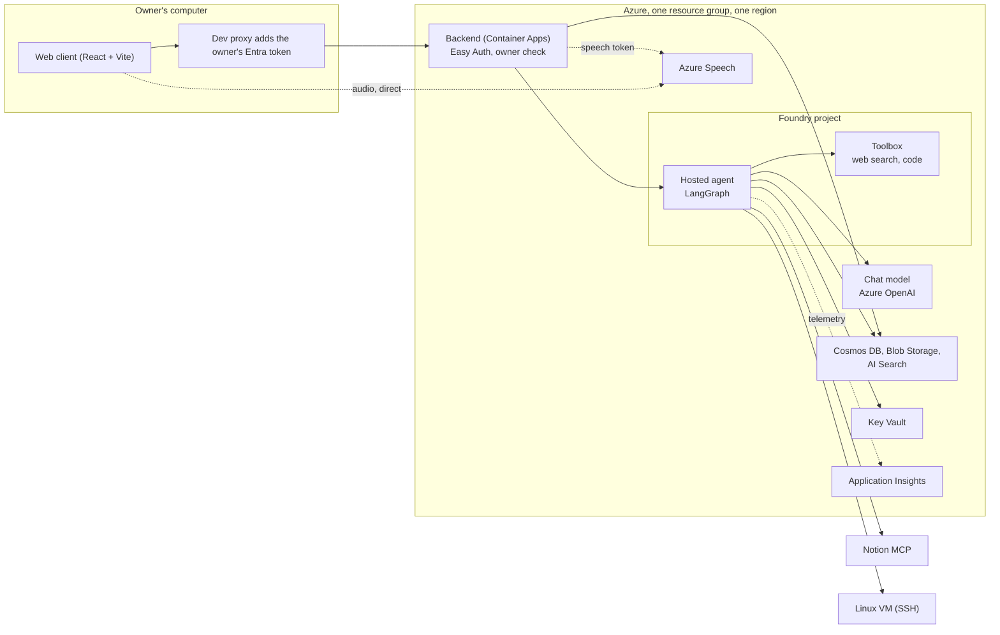

# SDD-002: Architecture and Azure infrastructure

- **Status:** Accepted
- **Version:** 2.0 (first written 2026-08-17)
- **Owner:** Ali Boussecsou
- **Related:** [SDD-001](sdd-001-mvp-scope-and-use-cases.md), [SDD-003](sdd-003-conversational-voice-runtime.md), [SDD-004](sdd-004-continuous-integration-and-delivery.md), [SDD-005](sdd-005-product-model-memory-and-interface.md)

## 1. Purpose

Define the technical architecture and the Azure services that Savant Azurian uses. All choices favour pure Azure, managed services where possible, and clear learning value.

## 2. System overview



The hosted target is a **Foundry hosted agent**. The agent is a LangGraph graph served through the Foundry Responses protocol.

## 3. Core components

| Layer | Technology | Why |
| --- | --- | --- |
| Orchestration | LangGraph | Explicit state, conditional routing, tool loops, interruptions |
| Runtime | Foundry hosted agent | The official Microsoft path: managed scaling, identity and observability |
| Speech | Azure Speech Services | Continuous recognition for interactive input; neural voices for output |
| Language model | Azure OpenAI through Foundry | A reference model, with the choice driven by benchmarks ([ADR-0004](../adr/0004-reasoning-model-reference.md)) |
| State | Cosmos DB | Projects, sessions and messages |
| Secrets | Key Vault and managed identities | No secrets in code or in environment variables ([ADR-0020](../adr/0020-keyless-access-with-entra-and-key-vault.md)) |
| Web client | React and Vite, run locally | Static Web Apps is unavailable ([ADR-0010](../adr/0010-monorepo-local-pwa-and-entra-owner-access.md)) |
| Backend (BFF) | Azure Container Apps | Learning value: Docker, revisions, ingress, scaling, managed identity |
| Observability | Application Insights and Azure Monitor | Standard |
| SSH target | A small Linux VM | A real SSH surface and a monitoring target |

## 4. Azure resources

**Required:** a resource group, a Foundry project and its hosted agent, Azure Speech, a Cosmos DB account, a Key Vault, a Linux VM with a network security group limiting SSH, Application Insights and a Log Analytics workspace, Azure Container Apps for the backend, and Blob Storage with Azure AI Search for retrieval.

**Optional or later:** a separate Azure OpenAI resource, Azure AI Document Intelligence for scanned documents.

The [configuration reference](../configuration.md) lists every setting these resources feed.

## 5. Security principles

- Secrets live only in Key Vault.
- Every workload runs with a managed identity and least-privilege RBAC.
- SSH is restricted by the network security group and by a pinned host key.
- No agent endpoint is exposed beyond Foundry's controls.
- Outside content is data, never instruction ([ADR-0019](../adr/0019-external-content-is-data.md)).
- Changes to Notion and to the VM need the owner's approval ([ADR-0017](../adr/0017-two-layer-authorization-for-notion-writes.md), [ADR-0018](../adr/0018-ssh-tool-with-a-semantic-command-judge.md)).

## 6. Tool implementation notes

| Tool | Implementation |
| --- | --- |
| Notion | The official Notion MCP server. Direct OAuth with dynamic client registration and PKCE through the backend, tokens encrypted in Blob Storage ([ADR-0009](../adr/0009-bff-owns-user-facing-oauth.md)) |
| SSH | `asyncssh`, one connection per command, private key in Key Vault ([ADR-0018](../adr/0018-ssh-tool-with-a-semantic-command-judge.md)) |
| Retrieval | An Azure AI Search tool inside the graph ([ADR-0021](../adr/0021-per-project-document-retrieval.md)) |
| Web and code | A Foundry Toolbox |
| Gmail | Planned originally (OAuth desktop client, refresh token in Key Vault); not delivered |

## 7. Decisions log

| Decision | Alternative considered | Why chosen |
| --- | --- | --- |
| LangGraph on a hosted agent | A pure Foundry prompt agent | Explicit multi-step control, project routing and custom tools |
| Azure Speech | ElevenLabs, Cartesia | Stay on Azure and on the credit |
| Gmail API directly | A Logic Apps connector | More control and fewer Google restrictions on consumer accounts |
| An Azure VM for SSH | Container Apps only | An explicit learning goal and a real SSH surface |
| Backend on Container Apps | Azure Functions | More learning value and portfolio quality |
| Cosmos DB | PostgreSQL, Redis | Native to Azure, serverless-friendly, good for conversational state |
| A local web client | Static Web Apps | Impossible on the subscription ([SPEC-002](spec-002-azure-for-students-constraints.md)) |
| Entra ID Easy Auth on the backend | The Static Web Apps `owner` role | That role exists only behind Static Web Apps ([ADR-0011](../adr/0011-entra-easy-auth-on-the-bff.md)) |

## 8. Retrieval architecture

| Layer | Service | Role |
| --- | --- | --- |
| Raw documents | Blob Storage | The original files, per project |
| Indexing and retrieval | Azure AI Search | Vector, keyword and hybrid search |
| Embeddings | An Azure OpenAI embedding model | `text-embedding-3-small` or equivalent |
| Optional parsing | Azure AI Document Intelligence | Complex or scanned PDFs, later |

Project isolation uses **one index with a `project_id` filter** that the server applies, not the model. An index per project was the alternative. Ingestion: upload to Blob Storage, chunk and embed, index with the project's identifier. Details in [ADR-0021](../adr/0021-per-project-document-retrieval.md).

## 9. Web client and backend

**The single-owner decision (2026-10-20).** One owner uses the web client and the playground. The backend verifies the owner's access, uses a stable logical key server-side, and passes it to the hosted agent so it can find the encrypted Notion tokens. There are no secondary accounts. The fixed key is not an authentication mechanism by itself.

```text
Web client (local, React + Vite)
        ↓  development proxy adds the owner's Entra token on the server side
Backend (Azure Container Apps), Easy Auth with Entra ID
        ↓  managed identity, scope https://ai.azure.com/.default
Foundry hosted agent (LangGraph)  →  Notion MCP, SSH, retrieval, toolbox
```

**Two distinct identities**

1. **Owner to backend:** Entra ID. Easy Auth checks the token before the backend. The readiness and callback routes stay public (anonymous requests allowed). The backend refuses everything else itself ([ADR-0011](../adr/0011-entra-easy-auth-on-the-bff.md)).
2. **Backend to hosted agent:** the backend's managed identity, with the *Foundry Agent Consumer* role.

**Backend routes.** Notion consent start and status, and the chat relay to the agent's `/responses` endpoint, each also available under an `/api` prefix. Later additions: projects, sessions and messages, document upload and listing, a Speech token ([SDD-005](sdd-005-product-model-memory-and-interface.md)).

**Calls from the owner's computer.** The web client calls a local proxy that adds the token (`az account get-access-token --resource api://<app-id>`, valid about one hour). The token never enters the browser, and CORS is unnecessary behind the proxy.

**Three distinct identifiers.** The owner object ID (access control), the fixed Notion storage key shared by the backend and the agent, and the app registration client ID (the token audience).

**Order of activation.** Turn on Easy Auth, set the owner values, and set the agent URL last. Without Easy Auth, the identity header can be forged.

## 10. Delivery

Continuous integration and delivery are described in [SDD-004](sdd-004-continuous-integration-and-delivery.md). Two points matter for the architecture: the agent and the backend are **independent delivery components**, and publishing a backend image to the registry does not roll out the Container App.

## Revision history

| Date | Change |
| --- | --- |
| 2026-08-17 | First version |
| 2026-09-02 | Conversational runtime update: live recognition and model-driven routing ([SDD-003](sdd-003-conversational-voice-runtime.md)) |
| 2026-09-03 | Alignment of the local implementation with the target architecture |
| 2026-10-20 | Notion architecture revised: direct OAuth through the backend, tools in the hosted agent |
| 2026-10-27 | Component-aware CI/CD proposed ([SDD-004](sdd-004-continuous-integration-and-delivery.md)) |
| 2026-10-30 | Static Web Apps dropped; local web client and Easy Auth proposed |
| 2026-10-31 | Single repository and owner access through Entra ID ([ADR-0010](../adr/0010-monorepo-local-pwa-and-entra-owner-access.md)) |
| 2026-11-09 | Rewritten as a single document |
