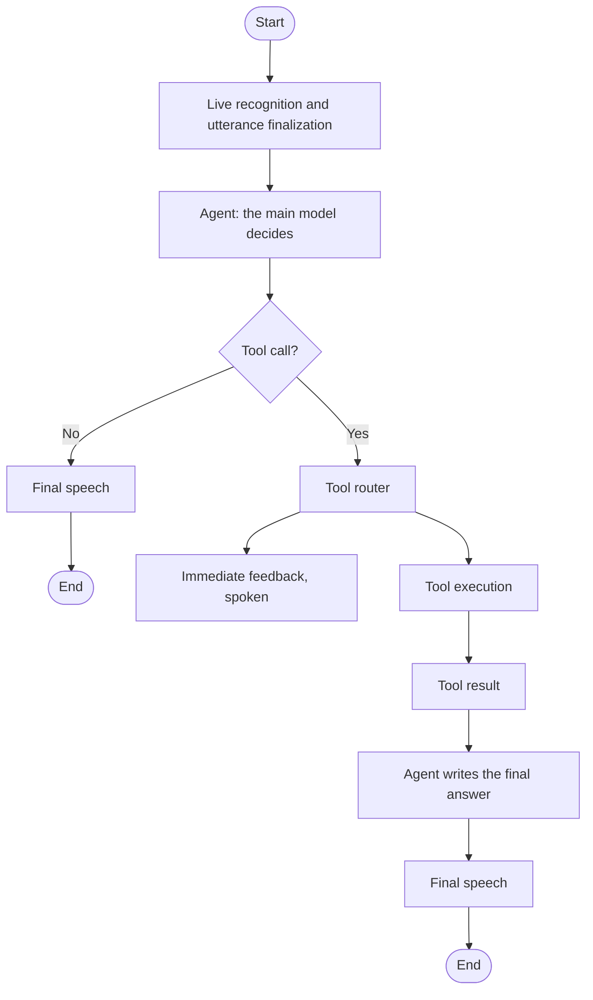
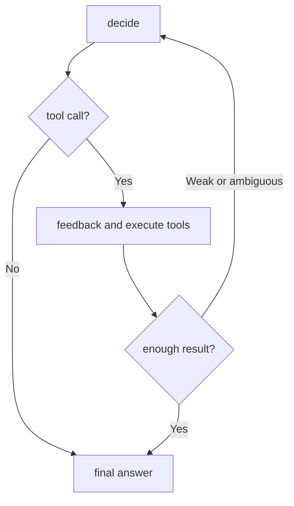

# SDD-003: Conversational voice runtime, tool routing and live feedback

- **Status:** Accepted. The runtime is delivered; the hosting changed (see [How it is hosted today](#10-how-it-is-hosted-today)).
- **Version:** 2.0 (first written 2026-09-02)
- **Owner:** Ali Boussecsou
- **Related:** [SDD-001](sdd-001-mvp-scope-and-use-cases.md), [SDD-002](sdd-002-architecture-and-azure-infrastructure.md), [ADR-0007](../adr/0007-live-stt-with-utterance-final-trigger.md), [ADR-0008](../adr/0008-main-llm-routes-tools-with-deterministic-feedback.md), [ADR-0015](../adr/0015-browser-voice-interface-contract.md)

## 1. Purpose

Define the conversational runtime: live speech input, model-driven tool routing, immediate spoken feedback while a tool runs, and the final spoken answer.

## 2. Target interaction

Savant behaves as a **conversational voice agent**, not as a long blocking request and response pipeline.

A simple request:

```text
User speaks → live recognition → final transcript → the model answers directly → speech → user hears the reply
```

A request that needs a tool:

```text
User speaks → live recognition → final transcript
  → the model receives the transcript, the context and the tool definitions
  → the model emits a tool call
  → the runtime starts, with minimum delay:
        1. a short spoken acknowledgement
        2. the tool execution
  → the tool result returns to the model
  → the model writes the final answer → speech → user hears the result
```

## 3. Speech input

Audio is recognized progressively instead of waiting for a complete file.

```text
Microphone → audio chunks → continuous recognition
  → partial events (live captions)
  → final event → the agent
```

Requirements:

- partial transcription may be shown live;
- the agent is triggered by the **final** utterance, never by each partial token, and never twice for one utterance;
- end-of-utterance detection is measurable and tunable (the local prototype used a silence threshold of 1,600 ms, chosen for natural conversation);
- the file-based path stays as a diagnostic fallback.

## 4. Agent decision model

The first semantic decision after recognition is made by the **main language model**. It receives the system instructions, the final transcript, recent conversation context, the tool definitions exposed through LangChain tool calling and the relevant runtime context. No separate routing model is used ([ADR-0008](../adr/0008-main-llm-routes-tools-with-deterministic-feedback.md)).

It returns either a normal answer or a structured tool call with a tool name and arguments.

## 5. LangChain and LangGraph

**LangChain** supplies the model and tool abstractions and exposes tool schemas to the model. **LangGraph** controls execution around the model's decision: state, conditional routing, tool execution, intermediate feedback, memory updates, retries and errors, tracing and timings. The model chooses semantically; LangGraph orchestrates operationally.

## 6. Immediate spoken feedback

When the model asks for a tool that will take noticeable time, Savant acknowledges the action before the result is ready.

| Tool | Default feedback |
| --- | --- |
| Notion search | "Je regarde dans Notion." |
| Notion page read | "Je consulte la page." |
| Calendar search | "Je vérifie ton calendrier." |
| Memory search | "Je regarde dans ma mémoire." |
| Web search | "Je cherche ça." |

Rules:

- feedback is **deterministic** and mapped to the tool call;
- no extra model call is needed to produce it;
- the acknowledgement and the tool start with minimum sequencing delay;
- no acknowledgement for very fast internal operations, when it would make the conversation slower or more repetitive.

A later improvement may generate context-sensitive feedback, only if latency stays acceptable.

## 7. Graph state

The state supports at least: a conversation identifier, the audio or stream reference, the partial and final transcripts, recent messages, the model response, tool calls and results, the feedback message, the output audio, errors and per-stage timings.

## 8. Logical graph



## 9. Baseline and acceptance

**Baseline (2026-09-02, local, non-streaming).** About 1.6 s for recognition, 4.9 s for the model, 1 s for speech and 8.9 s in total. This motivated the runtime above.

**Acceptance criteria.** The runtime is validated when:

1. microphone audio is consumed continuously during speech;
2. partial recognition is visible or observable before the user finishes;
3. the final transcript triggers the agent once per utterance;
4. a simple greeting gets a direct spoken reply with no tool round trip;
5. a Notion request makes the model select the Notion tool;
6. a short spoken acknowledgement is emitted before the result is ready;
7. the action continues and returns a real result;
8. the final answer is grounded in that result;
9. the final answer is spoken;
10. timings and routing decisions are observable without exposing secrets.

**Non-goals for this iteration:** full-duplex speech, barge-in, persistent production memory, retrieval, a multi-agent architecture, and a separate routing model.

## 10. How it is hosted today

The first runtime was a local prototype with its own server and a persistent WebSocket carrying audio. The delivered system differs in where things run, not in what they do.

- **Recognition and synthesis run in the browser** with the Speech SDK, using a **10-minute token issued by the backend** with its managed identity. The backend never receives audio, and only the **final text** goes through the existing chat endpoint ([ADR-0015](../adr/0015-browser-voice-interface-contract.md), [voice contract](../voice-contract.md)).
- The chat request carries a channel marker, so the agent answers in a short, oral style.
- While tools run, the web client plays **fixed announcements** from a table of phrases, without calling the model.
- A faster first model call without tools answers tool-free turns and hands over to the full agent when a tool is needed.
- The Easy Auth question about WebSockets, left open earlier, no longer applies: no audio WebSocket goes through the backend.

The pipeline was validated against the deployed agent with a round-trip script that sends a spoken question through recognition, the agent and synthesis: one direct answer and one Notion tool call ([validation report](../voice-live-validation-2026-11-03.md)). The report also lists what still needs a real microphone in the web client.

## 11. Bounded Notion search (design of 2026-09-03)

A system prompt alone is not enough to make Notion searches proactive and robust. The prompt must say that the voice message is a **transcription** that can contain homophones, misspellings, wrong spaces or uncertain case, and the model must use the context and earlier results. The graph needs a controlled loop:



The budget was three Notion actions per turn at most (two searches and one page read), an immediate stop once one source answers clearly, a short clarification if several readings stay plausible, and no write. Every query is traced, and Notion content stays untrusted data.

The hosted agent replaced this per-tool budget with the general limits of [ADR-0022](../adr/0022-bounded-tool-execution.md) (a loop guard after 8 tool-requesting steps, timeouts and retries).

## 12. Future evolution

Streaming speech output, barge-in and cancellation, full duplex, contextual acknowledgements, persistent memory and project context, more tools and permission policies, and production observability.

## Revision history

| Date | Change |
| --- | --- |
| 2026-09-02 | First version |
| 2026-09-03 | Implementation state of the local runtime; the bounded Notion loop |
| 2026-10-30 | Hosting context: local web client, backend on Azure |
| 2026-11-09 | Rewritten as a single document, with the hosting as delivered |
