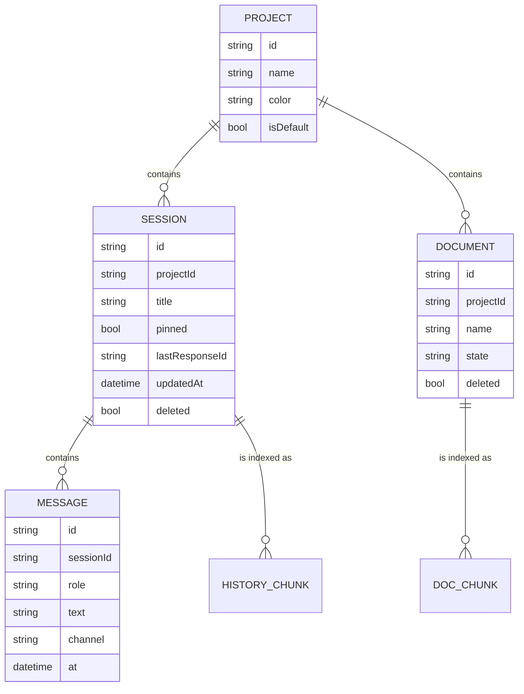
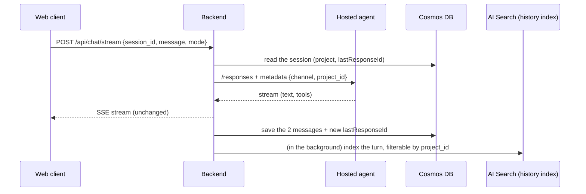

# SDD-005: Product model, long-term memory and the new interface (projects, sessions, retrieval)

- **Status:** Approved by the owner on 2026-11-05. Partly implemented; see [Implementation status](#implementation-status).
- **Version:** 2.0 (first written 2026-11-04)
- **Owner:** Ali Boussecsou
- **Related:** [SDD-001](sdd-001-mvp-scope-and-use-cases.md), [SDD-002](sdd-002-architecture-and-azure-infrastructure.md), [SDD-003](sdd-003-conversational-voice-runtime.md), [ADR-0012](../adr/0012-sessions-and-projects-behind-a-session-store.md) to [ADR-0016](../adr/0016-single-stylesheet-one-motion-switch-pure-modules.md), [ADR-0021](../adr/0021-per-project-document-retrieval.md)

> **Why a design document and not an ADR?** An ADR records **one** decision. This document describes a **set**: the data model, the memory, the search, the interface and the delivery plan. Its important decisions are still listed one by one in [section 11](#11-decisions), in short ADR form, so each can be found and challenged separately.

## Implementation status

Reviewed on 2026-11-09 from the repository's documentation and code. The design below is kept as it was approved; this table says what became of it.

| Part of the design | Status |
| --- | --- |
| Projects and sessions, `Main` indelible, local store behind a `SessionStore` | **Delivered** ([ADR-0012](../adr/0012-sessions-and-projects-behind-a-session-store.md)) |
| New interface (orb, rail, dock, settings, palette, mobile) | **Delivered** ([ADR-0013](../adr/0013-interface-shows-only-what-exists.md) to [ADR-0016](../adr/0016-single-stylesheet-one-motion-switch-pure-modules.md)) |
| Sessions and messages in Cosmos DB, backend routes, `session_id` in the chat, `project_id` sent to the agent | **Delivered** ([workspace documentation](../workspace-cosmos.md)) |
| Documents per project: upload, indexer with integrated vectorization, search | **Delivered**, as a single `search_documents` tool instead of `recall` ([ADR-0021](../adr/0021-per-project-document-retrieval.md)) |
| **Memory of past sessions** (an index per turn, pushed by the backend; `recall`, `read_session`, `recent_sessions`; the "Used memory" chip) | **Not implemented.** Deferred |
| Canvas, attachments in the composer | Off by design ([D9](#11-decisions)) |

## 1. The problem in one sentence

Savant had **a single conversation**, kept in the browser, and it **forgot everything** as soon as another one started. The goal:

1. **file** the work: **projects** that contain **sessions** (the chats) and **documents**;
2. **remember**: the agent can read the context of past sessions and of a project's documents, through **Azure AI Search**;
3. **a new interface**: the orb in the centre, sessions and projects on the left, the thread on the right.

## 2. Summary

| Topic | Decision |
| --- | --- |
| Vocabulary | "Conversation" becomes **Session**. Sessions live in **Projects**. The `Main` project always exists and cannot be deleted. |
| Where data lives | **Cosmos DB** (projects, sessions, messages), **Blob Storage** (document files), **Azure AI Search** (the searchable index). |
| Memory | **Three layers**: the current session (already there), past sessions of the project (new, searchable), the project's documents (new, searchable). |
| How the agent remembers | **Read tools**: `recall` (search the project's history and documents), `read_session` (reread one session). They need no approval because they change nothing. |
| Isolation | Every search is **filtered by project on the server**. The model never chooses the project. |
| Forgetting | Deleting a session or a document also removes it from the index: what Savant no longer shows, it no longer remembers. |
| Interface | The prototype's orb, rail, thread, settings and command palette, with a few UX improvements ([section 8](#8-the-new-interface)). **Canvas is off** for now. |
| Order | 1) interface and model, local; 2) sessions in Cosmos DB; 3) session memory in AI Search; 4) documents; 5) finishing. |

## 3. Vocabulary

| Word | What it is | Analogy |
| --- | --- | --- |
| **Project** | A work folder: "Savant Azurian", "Cloud study"… `Main` is the default. | A binder |
| **Session** | A chat, with a start and a title. Belongs to **one** project. | A folder in the binder |
| **Message / turn** | A message from the owner or from Savant. A **turn** is a question and its answer. | A page in the folder |
| **Document** | A file added to a project (PDF, Markdown…) that Savant can consult. | An appendix of the binder |
| **Index** (AI Search) | A searchable copy of texts, cut into small pieces. | The index at the back of a book |
| **Chunk** | A small piece of text (a turn, or a passage of a document) stored in the index. | An index card |
| **Embedding** | A list of numbers that represents the **meaning** of a text. Similar texts have similar numbers. | The GPS coordinates of an idea |
| **Hybrid search** | Searching by **words** (like Ctrl+F) and by **meaning** (embeddings), then combining both. | Looking by title **and** by topic |
| **Retrieval-augmented generation** | Before answering, the agent **fetches** the right excerpts and reads them. | Reviewing your notes before answering |
| `conversation_id` | Already existing: Foundry's identifier of the **last response**, used to continue a thread. It becomes a field **of the session**. | A bookmark |

## 4. The product model

### 4.1 Logical schema

### 4.2 The rules, in plain words

1. **Everything belongs to a project.** A session or a document never exists "outside a project". The default is `Main`.
2. **One session, one project.** A session can be **moved** to another project; its memory follows.
3. **Foundry's thread stays the working memory.** The session keeps `lastResponseId` (the former `conversation_id`) to continue the chat. What Foundry already does well is not copied.
4. **Store the text, not the backstage.** A message keeps its role, final text, channel (`text` or `voice`), date, and the **names** of the tools used with their duration. **Not** the tools' arguments or results, which stay in the backend.
5. **Delete means forget.** Deleting a session or a document marks it `deleted`, then removes it from the index. An "Undo" of a few seconds exists in the interface before the deletion is final.
6. **One owner.** All data belongs to the single owner. No sharing, no multi-account.

### 4.3 Two worked examples

| | Project **Main** | Project **Savant Azurian** |
| --- | --- | --- |
| Sessions | "Ideas for voice mode", "Weekly planning" | "Hosted agent phase plan", "Easy Auth debugging" |
| Documents | `voice-notes.md` | `SDD-003-voice-runtime.pdf`, `ADR-0011-easy-auth.md` |
| A question asked in a session of the project | "What did I want for voice again?" | "What did we find about the Easy Auth 401?" |
| What a search covers | sessions and documents of **Main** only | sessions and documents of **Savant Azurian** only |
| Expected result | finds "Ideas for voice mode" | finds "Easy Auth debugging" and `ADR-0011`, and **never** the notes of Main |

## 5. Long-term memory

### 5.1 Three layers, newest to oldest

| Layer | Content | Where | Status |
| --- | --- | --- | --- |
| **1. Working memory** | The thread of the current session | Foundry (LangGraph checkpoints, `previous_response_id`) | Delivered |
| **2. Session memory** | The turns of the project's **other** sessions | Cosmos DB, then an `sa2-history` index in AI Search | Not implemented |
| **3. Document memory** | The project's documents, cut into passages | Blob Storage, then an `sa2-docs` index in AI Search | Delivered |
| *(Later)* **4. Durable facts** | "I prefer short answers", "my VM is called…" | to be decided | Out of scope |

**Why not put everything in Foundry's thread?** A session's thread grows with every turn and costs tokens on every call. Long-term memory works differently: it does not **reread everything**, it **searches** for the few useful excerpts. It is like a library: you do not carry every book, you fetch the right page.

### 5.2 What is indexed, and what is not

| Indexed | Never indexed | Why |
| --- | --- | --- |
| The owner's question and Savant's final answer (a **turn** is one chunk) | Tool results (Notion content, SSH output, web pages) | Notion content already lives in Notion, and text from the web can hold malicious instructions that must not be laundered into memory. |
| Session title, project, date, channel | The model's reasoning, tokens, OAuth codes | Nothing secret in the index. |
| Passages of the documents added | Technical error messages | Noise. |

### 5.3 How a turn becomes a memory (write path, designed, not implemented)

**Choice: the backend "pushes" each turn into the index** right after the answer. It computes the embedding with the embedding deployment, then sends the chunk to AI Search. If indexing fails, the chat **does not break**: the failure is logged and retried later.

> **Why push for history, and not an indexer?** An AI Search *indexer* can read Cosmos DB by itself, but it runs at best **every 5 minutes**. On the **Free** tier, AI enrichment (chunking and embeddings through a *skillset*) is limited to **20 documents per indexer and per day** (Microsoft "Service limits"). For a chat, that is exceeded quickly and the memory arrives late. With push, the turn is searchable seconds later, and we choose **exactly** what enters the index. The cost is a little code in the backend.

For **documents**, the **Blob indexer** with integrated vectorization is kept: adding a file is rare, a few minutes of wait is acceptable, and it is the "Azure-native" way to do retrieval (data source, skillset, index, indexer).

### 5.4 How Savant remembers (read path, designed)

| Tool | What it does | Example request |
| --- | --- | --- |
| `recall(query, source="all" \| "sessions" \| "documents", limit=5)` | **Hybrid** search (words and meaning) in the indexes, **filtered by the active project**. Returns short excerpts with their source (session title and date, or document name). | "What did we decide about Easy Auth?" |
| `read_session(session_id)` | Rereads the last turns of a session **of the same project** (found by `recall`). | "Pick up where we stopped yesterday." |
| `recent_sessions(n=5)` | Lists the project's last sessions (title, date, message count). | "What did we talk about this week?" |

Rules:

- These are **reads**: they run without approval, with the same timeouts and single retry as other reads ([ADR-0022](../adr/0022-bounded-tool-execution.md)).
- The **project is not an argument** the model can choose. The backend sends it in `metadata.project_id` (like `metadata.channel` for voice), the agent reads it when building the input, and the tool applies it as a **server-side filter**. A malicious prompt cannot make it read another project.
- What comes back from the index is **untrusted data**, like web pages and Notion: a sentence from the past is never an order ([ADR-0019](../adr/0019-external-content-is-data.md)).
- The agent's query is vectorized **by AI Search itself** (a vectorizer in the index). The agent only sends text.
- Searching **all projects** happens only if the owner asks explicitly ("in all my projects"), through a `scope="all"` argument, and the answer always names the source project.

### 5.5 Why separate projects?

Without a filter, a question about "the VM" could bring back notes from an unrelated context. By filtering by project, each project has **its own** memory, like a colleague who does not mix the files of two clients. It is also a protection: nothing "leaks" from one project to another by mistake.

## 6. Where data lives (Azure)

| Service | Role | Setting | Why |
| --- | --- | --- | --- |
| **Cosmos DB for NoSQL** | Source of truth: projects, sessions, messages, document metadata | **Serverless**, database `sa2`, containers `projects`, `sessions`, `messages` (partition key `/sessionId`) | Simple JSON data, near-zero cost for one user, access with a managed identity |
| **Blob Storage** | The files of the documents | A `documents` container, path `{projectId}/{documentId}/{name}` | The existing account is reused |
| **Azure AI Search** | Hybrid search | The **Free** tier to start (limits to watch), with the history and documents indexes | The service the project wants to learn; Free is enough to validate |
| **Embedding deployment** | Turn text into vectors | An embedding model such as `text-embedding-3-small`, on the existing Azure OpenAI or Foundry resource | Needed for search by meaning |

**Identities and roles** (granted explicitly, see the [role matrix](../deployment.md#roles)):

| Identity | Role | On |
| --- | --- | --- |
| Backend | Cosmos DB Built-in Data Contributor | the Cosmos account |
| Backend | Search Index Data Contributor | the search service |
| Backend | Storage Blob Data Contributor | the `documents` container |
| Backend | Cognitive Services OpenAI User | the resource that hosts the embeddings |
| Hosted agent | Search Index Data Reader | the search service |
| Hosted agent | Cosmos DB Built-in Data Reader | the Cosmos account (for `read_session`, not implemented) |
| Search service identity | Storage Blob Data Reader and Cognitive Services OpenAI User | the `documents` container and the embedding resource |

No key anywhere: everything uses managed identities and RBAC ([ADR-0020](../adr/0020-keyless-access-with-entra-and-key-vault.md)).

**Alternative rejected.** Cosmos DB can also do vector search, which would avoid AI Search. It was rejected because the project's goal is to learn AI Search, and because AI Search brings hybrid search and ready-made document indexers.

## 7. Backend API (new routes, owner only)

| Route | Use |
| --- | --- |
| `GET/POST /api/projects`, `PATCH/DELETE /api/projects/{id}` | List, create, rename, delete (except `Main`) |
| `GET/POST /api/sessions?project={id}`, `PATCH/DELETE /api/sessions/{id}` | Create, rename, pin, move, delete sessions |
| `GET /api/sessions/{id}/messages` | Reload a thread |
| `POST /api/chat/stream` | **Unchanged**, plus `session_id`; the backend derives the project and `lastResponseId` |
| `POST /api/projects/{id}/documents`, `GET …/documents`, `DELETE …/documents/{docId}` | Documents |

Same rules as the existing routes: Easy Auth and the owner's Entra identifier, and **never** logging IDs, text or query strings. Any module newly imported by the backend must be added to the backend's source list in the component registry ([SDD-004](sdd-004-continuous-integration-and-delivery.md)).

## 8. The new interface

The base is the interface prototype and its technical integration report. The report stays the **detailed reference** (tokens, sizes, orb rendering, motion rules); this section gives the choices and the differences.

### 8.1 Kept as is

- **The orb** (canvas, seven coloured states, a halo that reacts to the microphone level, a glow on the floor), a little below the middle, with the **state chip** (glyph and label, not only a colour) and the **legend** under it.
- The three zones: **rail** on the left, **stage** (orb) in the centre, **dock** (thread and composer) on the right.
- **Settings** in a drawer, with tools as cards (Notion, Web search, Linux VM; Outlook hidden while it is paused).
- The **palette** (Ctrl or ⌘ + K), **focus mode**, the **mobile** layout (a bottom bar), **toasts with Undo**, and the motion rules (fast, interruptible, reduced motion respected).
- **Copyable ID chips** in the thread (UUIDs, correlation identifiers).

### 8.2 Switched off for now

- **Canvas**: off (`CANVAS_ENABLED = false`). The dock shows only the thread.
- **Attachments in the composer**: off. Documents go through projects.
- **Approval digest and countdown**: not shown, because the server does not expose them.

### 8.3 UX improvements over the prototype

| # | Prototype | Proposal | Why |
| --- | --- | --- | --- |
| 1 | Sessions appear **twice**: in the Sessions tab **and** in the Projects tree. | **Sessions** is the active project's list (with an "All" button). **Projects** shows projects as **cards**: name, colour, session count, **documents** and what Savant "knows" about the project. Clicking a project activates it and returns to Sessions. | One object, one place. Less scrolling, fewer duplicates to keep in sync. |
| 2 | Memory is invisible. | Under an answer, a chip **"Used memory · 2 past sessions · 1 document"** when the agent called `recall`, clickable to see the sources. | You know **why** Savant knows something. Trust and control. |
| 3 | Approve and Reject buttons that look like they validate directly. | The buttons **send a message** ("Yes, go ahead." / "No, do not do it."), and by voice you just say "yes". The card then shows the outcome **announced by the agent**. | Real approval stays conversational; the interface must never bypass it ([ADR-0014](../adr/0014-approval-stays-conversational.md)). |
| 4 | The orb's legend does not show what the agent is doing. | While "Thinking", the legend shows the **announcement already spoken** ("I'm searching your Notion."). | What you hear and what you read say the same thing. |
| 5 | The journal disappears. | It becomes **Settings, Diagnostics** (response times, tools, errors). | The diagnostic tool stays without cluttering navigation. |
| 6 | A new session is empty until the first message. | An empty session is **not** saved server-side until a message has gone; the title is generated from the first message. | No ghost "New session" entries piling up. |
| 7 | Switching sessions during an answer. | The answer continues and is written to **its** original session; the voice stops. | No answer lands in the wrong chat. |
| 8 | Projects described as isolated when they are not yet. | Until the memory exists, the help says "Projects group your sessions."; the word "memory" appears only once it exists. | The interface never promises what does not exist yet. |

### 8.4 Honesty rules (non-negotiable)

1. Never display an action, a connection or an approval as successful if it did not happen.
2. The speech-to-text, agent and text-to-speech durations shown are **measured**, never invented.
3. Web search and SSH read "Managed by the agent", not "Connected" (the web client cannot verify them).
4. The Documents card appears only when real indexing exists.
5. All interface strings are in **English**. Spoken phrases stay French by default.

## 9. End-to-end scenarios

**S1: A new voice session in Main.** You touch the orb and say "What's the weather in Rome?". A session is created in `Main` at the first message, titled "Weather in Rome". During the search you hear "I'm searching the web." then a short follow-up. The answer is short and spoken. The turn is saved in Cosmos DB.

**S2: Finding a past decision** *(needs session memory, not implemented).* In the project *Savant Azurian*, you ask "What did we find about the Easy Auth 401?". The agent calls `recall`, which finds the session "Easy Auth debugging" from three days ago. It answers citing the session and its date. Under the answer: "Used memory · 1 past session".

**S3: Resuming an old session.** You open "Hosted agent phase plan" in the rail. The thread reloads from Cosmos DB and the chat continues thanks to `lastResponseId`. If Foundry refuses a thread that is too old, the interface offers "Start fresh in this session": the text stays displayed, a new thread starts.

**S4: Adding a document, then asking about it.** In Projects › Savant Azurian › Documents you add `SDD-003.pdf`. Its state goes Uploading, Indexing, Ready. You ask "Summarize the barge-in part of SDD-003"; a document search finds the passages and the answer cites the document.

**S5: A Notion write with approval.** "Create a note for the weekly review." The agent prepares the operation and you hear "I'm preparing the page." The "Approval needed" card appears; you say "yes" or press the button, which sends "Yes, go ahead.". The semantic approval and the single-use ledger apply ([ADR-0017](../adr/0017-two-layer-authorization-for-notion-writes.md)). The Notion page content is not indexed.

**S6: Isolation.** In `Main`, you ask "What did we say about Easy Auth?". The search covers only `Main`, finds nothing, and the agent says so, offering to search all projects. If you answer "yes, search everywhere", it runs again with `scope="all"` and names the source project.

**S7: Forgetting.** You delete the session "Easy Auth debugging". An "Undo" toast stays for 6.5 s. Then the session is marked deleted in Cosmos DB and its chunks are removed from the index. The S2 question no longer finds it.

## 10. Delivery plan

| Phase | Content | Azure? |
| --- | --- | --- |
| **1. Interface and model, local** | The new interface; several sessions and projects in the browser behind a replaceable `SessionStore`; migration of the old chat. Canvas off. | No: web client only |
| **2. Sessions in Cosmos DB** | A Cosmos account, `/api/projects` and `/api/sessions`, `session_id` in the chat, `metadata.project_id` to the agent, the store wired to the backend | Yes: Cosmos and roles |
| **3. Session memory** | The search service, an embedding deployment, a history index, push indexing by the backend, `recall` / `read_session` / `recent_sessions`, the "Used memory" chip | Yes: AI Search, embeddings, roles |
| **4. Documents** | A `documents` container, upload, a Blob indexer with integrated vectorization, a documents index, the Documents card | Yes |
| **5. Finishing** | Accessibility, mobile, Diagnostics, then Canvas if time allows | No |

Each phase is cut into **small pull requests**. A reminder from delivery: a pull request touching the agent's runtime code **redeploys the agent** when merged; a backend pull request publishes the image, and updating the Container App stays manual ([SDD-004](sdd-004-continuous-integration-and-delivery.md)).

## 11. Decisions

| # | Decision | Alternative rejected | Reason |
| --- | --- | --- | --- |
| D1 | "Conversation" becomes **Session**, filed in a **Project**; `Main` cannot be deleted. | Keep a single conversation | The need to file and find things. |
| D2 | **Cosmos DB** is the source of truth for sessions and messages; Foundry stays the working memory. | Leave everything in Foundry | Foundry cannot list, rename or file sessions by project. |
| D3 | Memory in **three layers**; durable facts are deferred. | Summarize each session into a "profile" | Simpler and more verifiable; add durable facts when the rest works. |
| D4 | History indexed **per turn**, **pushed** by the backend. *(Not implemented.)* | A Cosmos to AI Search indexer | Freshness (seconds against 5 minutes), control over what is indexed, the Free tier's enrichment limit. |
| D5 | Documents by **Blob indexer and integrated vectorization**. | A homemade push | Infrequent, and it is the Azure-native route to learn. |
| D6 | The **project is imposed by the server** (`metadata.project_id`), never chosen by the model. | A free tool argument | Guaranteed isolation, even against prompt injection. |
| D7 | **Tool results** are never indexed. | Index everything | Confidentiality, no duplicate of Notion, no malicious text stored as memory. |
| D8 | Deleting a session or a document **also erases it from memory**. | Independent memory | What is no longer visible must no longer be "known". |
| D9 | **Canvas off** until retrieval is done. | Port it right away | No artifact channel on the server; memory comes first. |
| D10 | The rail does **not duplicate** sessions between tabs (§8.3 item 1). | The prototype's tree | One object, one place. |

## 12. Questions (answered on 2026-11-05)

All proposed defaults were kept. The one exception, Q2, was deferred to when the search resource was created.

| # | Question | Answer |
| --- | --- | --- |
| Q1 | Keep the **Projects tab as cards** (§8.3 item 1) or the prototype's tree? | Cards. |
| Q2 | AI Search tier: **Free** to validate, or **Basic** right away? | Decided when the resource was created. The chosen region offers Free, Basic, Standard and more. |
| Q3 | **Cross-project** search: only on explicit request? | Yes. |
| Q4 | Where does the journal live? | Settings, Diagnostics. |
| Q5 | Keep history **in the browser** as well as in Cosmos DB (offline mode)? | No: Cosmos DB alone, plus a light cache of the open session. |
| Q6 | Retention: keep everything, or purge after N months? | Keep everything (one user, small volume). |
| Q7 | Composer `/` commands: only `/id` and `/code`? | Yes. |

## 13. Out of scope

- Canvas, reports and charts (D9)
- Interrupting the voice (barge-in), a later step of the voice work
- Durable facts and profile (layer 4)
- Multi-user and project sharing
- Outlook, which is paused
- Private networking and hardening

## 14. Acceptance criteria

1. **Product model:** this document is reviewed and approved, with the answers to section 12.
2. **Phase 1:** the new interface runs locally with several sessions and projects, the old chat is migrated, the web client's tests and build pass, and the four resolutions and two themes of the report were checked.
3. **Phase 2:** a session created on the computer is found again after a reload (Cosmos DB), and the agent receives the right `project_id`.
4. **Phase 3:** scenarios S2, S6 and S7 pass for real, with evidence (a screenshot and correlated turn logs).
5. **Phase 4:** scenario S4 passes for real.
6. No key or secret is added, and every role is granted explicitly and listed in the documentation.

## 15. Phase 1: implementation notes (2026-11-05)

Phase 1 (interface and model, local) was written and verified. Nothing was deployed: the web client runs locally and the `pwa/` folder triggers neither delivery nor a backend publication.

### 15.1 What was done

| Area | Delivered |
| --- | --- |
| Model | Projects (`Main` indelible, unique names, six colours) and sessions (automatic title, pin, move, delete with Undo, a draft per session, a `conversationId` per session). The rules live in a pure, tested reducer. |
| Storage | A `SessionStore` interface and a `localStorage` implementation; a one-time migration of the old chat into a session of `Main`; blocked or full storage handled without errors. |
| Rail | A **Sessions** tab (active project or "All"; Pinned, Today, Yesterday and Earlier groups; search in titles and text; rename with F2, double-click or menu; a ⋯ menu and right-click) and a **Projects** tab of **cards**, with no duplicated sessions (D10). |
| Stage | The canvas orb (seven states, audio halo), the state chip, a live legend (partial hypothesis, final text, tool announcement while thinking, highlighted words while answering), FR/EN, Mute, End. |
| Thread | Tool steps, copyable ID chips and a "Recent IDs" tray, copying an answer or a session as Markdown, **measured** speech-to-text, agent and text-to-speech chips, the simplified approval card, "Open connections" when the agent reports Notion is not connected, and "Start fresh in this session" after the agent refuses a thread. |
| Composer | A draft per session, a technical mode, `/id` and `/code` commands, and kept Markdown shortcuts. |
| Settings | Tool cards (Notion, Web, VM, Gmail "Planned"), voice (language, read aloud), appearance (theme, reduced motion), **Diagnostics** and the account. |
| Other | The command palette, focus mode, a drawer and a bottom bar on mobile, and banners (access denied, offline, tool unavailable). |

### 15.2 Left off on purpose

- **Documents** (`DOCUMENTS_ENABLED = false` at that point): the card appears only with real indexing (§8.4 item 4). The upload and per-project list therefore waited for phase 4. *Documents were enabled later.*
- **Canvas** and **attachments**.
- **"Used memory"** and any mention of memory in the projects help: phase 3.

### 15.3 Differences from this document and from the integration report

1. A `messageCount` was added to the session, to know whether it is empty and to show "N msg".
2. No "Auto" mode for the voice language: French (default) or English, chosen by the owner.
3. The approval card relies on a **hint** (the last turn used a write-class tool and ends on a question), because the backend relays no approval signal. It only types the owner's answer.
4. The microphone level comes from a second microphone capture; if the browser refuses, the orb falls back to a default level.
5. Reduced motion has one source (`data-motion` on `<html>`); the old media-query block is gone.

### 15.4 Decisions recorded

[ADR-0012](../adr/0012-sessions-and-projects-behind-a-session-store.md) (the `SessionStore`), [ADR-0013](../adr/0013-interface-shows-only-what-exists.md) (the interface shows only what exists), [ADR-0014](../adr/0014-approval-stays-conversational.md) (approval stays conversational), [ADR-0015](../adr/0015-browser-voice-interface-contract.md) (the browser voice contract), [ADR-0016](../adr/0016-single-stylesheet-one-motion-switch-pure-modules.md) (one stylesheet, one motion switch, pure modules).

### 15.5 Verification and limits

- 194 unit tests, a type check and the production build passed at that point.
- A Playwright pass (Chromium, mocked backend) covered migration, reload, an answer bound to its session, F2, deletion and Undo (session and project), the palette, the `/` menu, the technical mode, the approval card, the offline banner, a voice error, no horizontal overflow at 390 px, and widths of 1440, 1920, 1000 and 390.
- **Not verified:** the real voice (microphone, Speech token, highlighted words, mute), Safari and Firefox, screen readers, real phones, orb performance on mobile, and resuming a very old Foundry thread.

## Revision history

| Date | Change |
| --- | --- |
| 2026-11-04 | First version |
| 2026-11-05 | Approved by the owner; phase 1 implementation notes |
| 2026-11-09 | Rewritten in English as a single document, with the implementation status and the deferred session memory |
