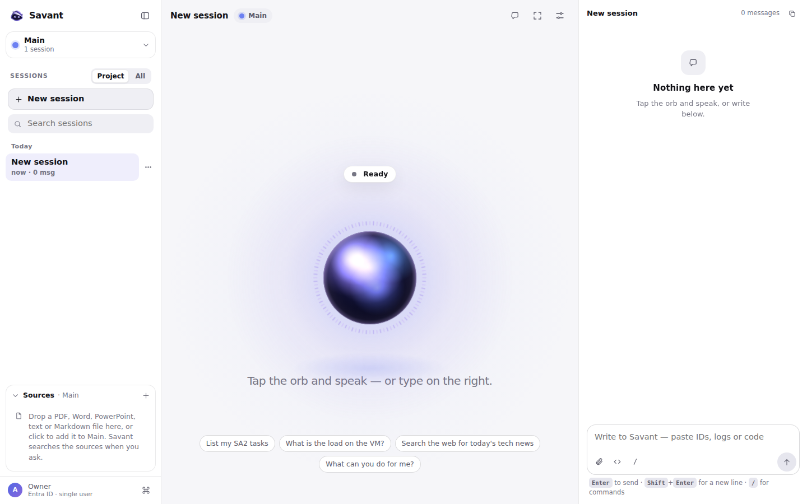
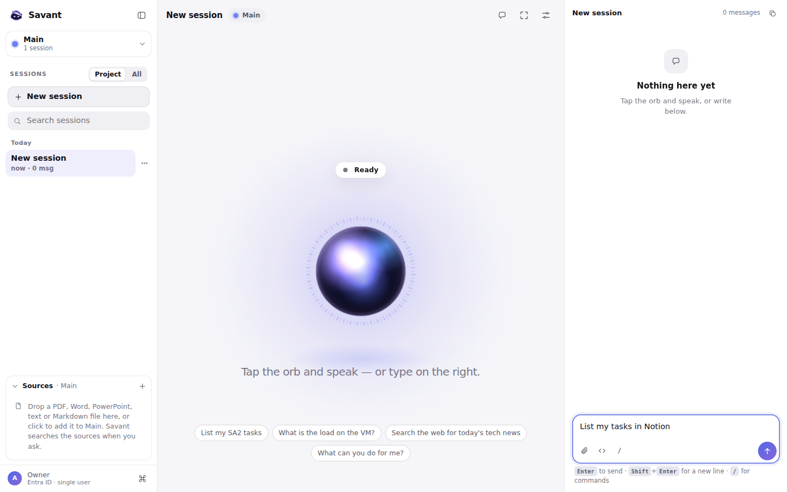
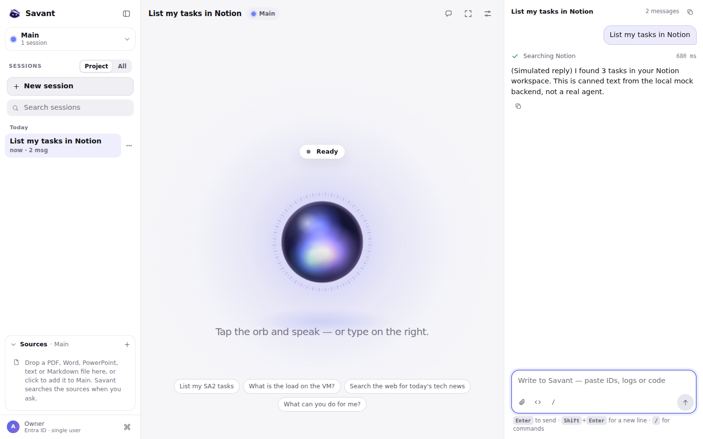
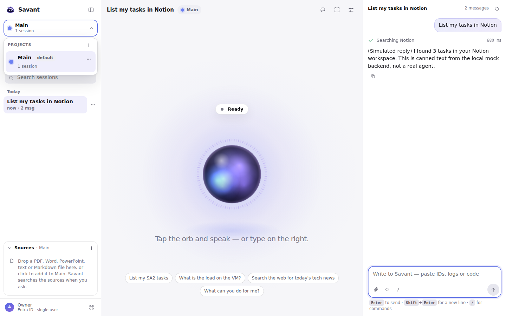
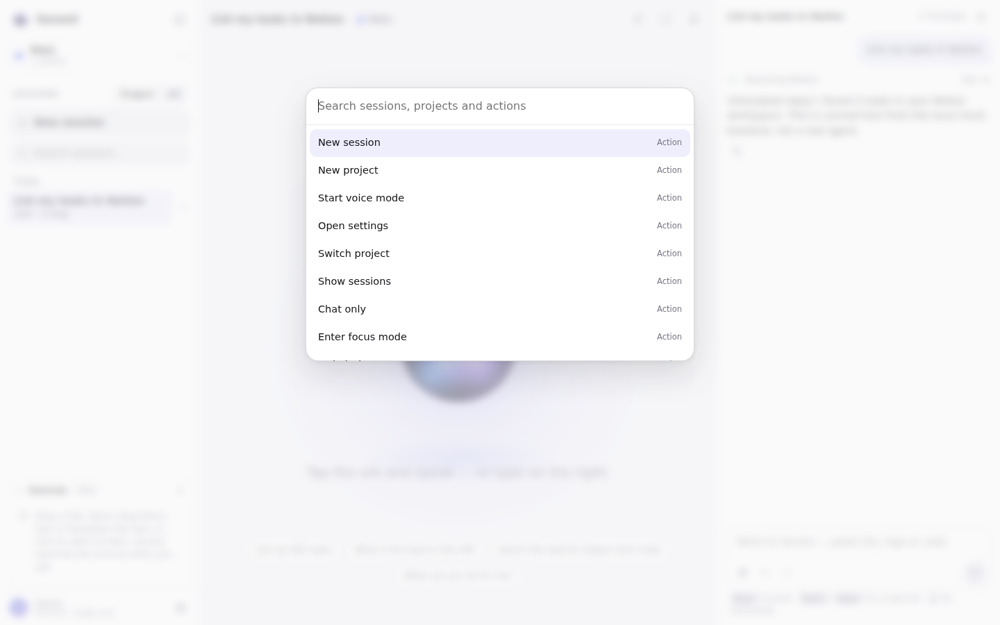
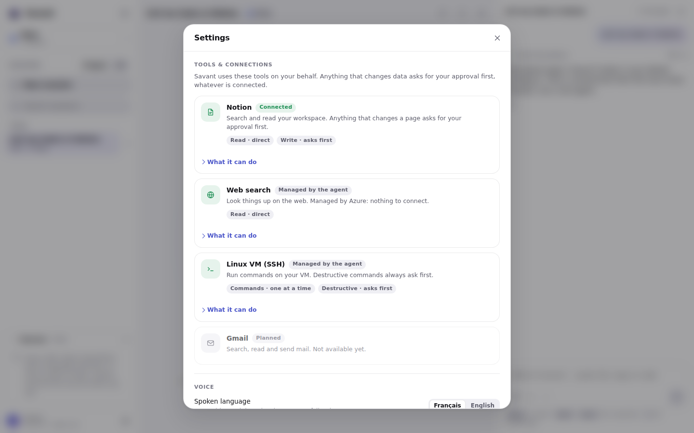
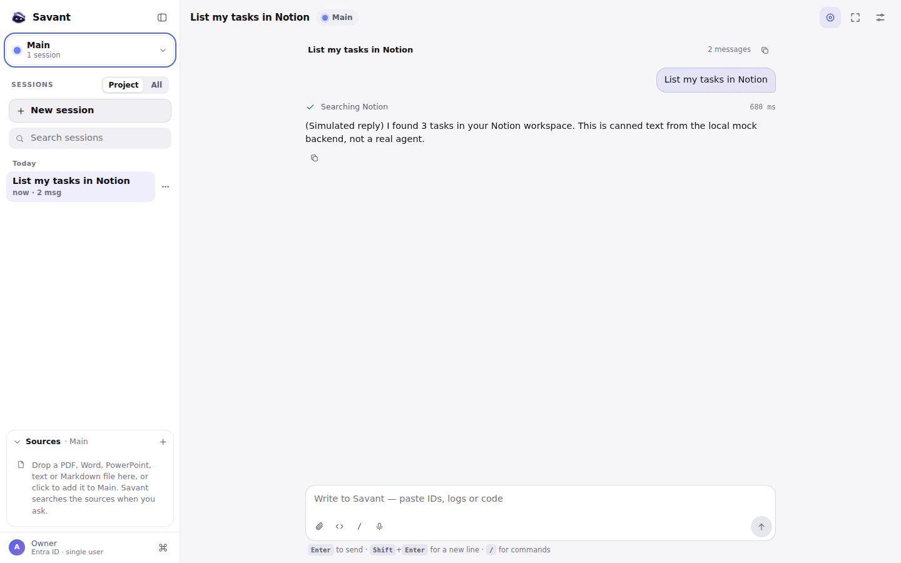
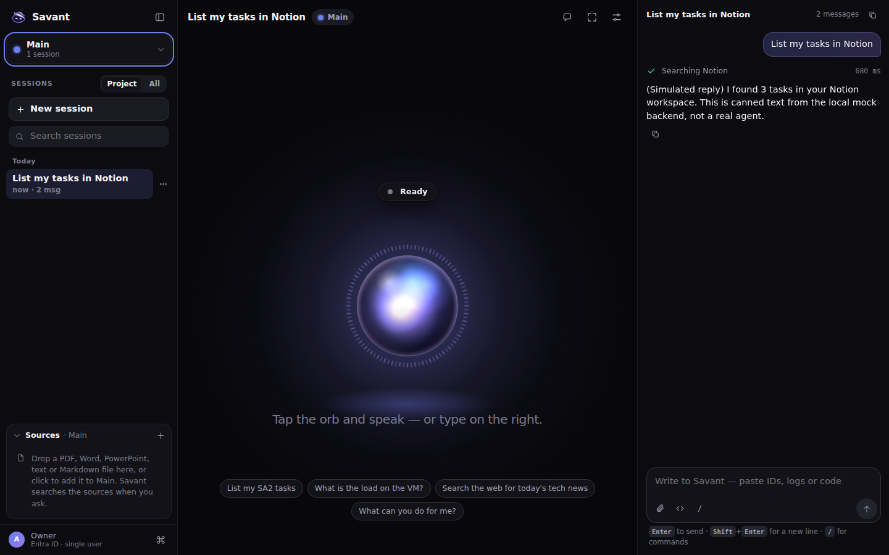
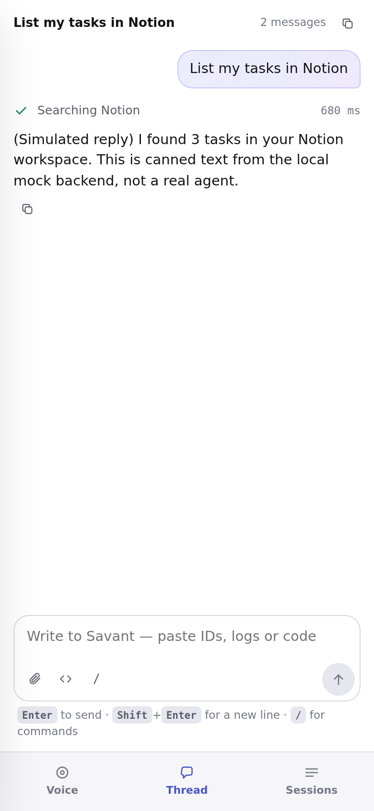

# User guide

How to use the Savant web client: talk or type, work in projects and sessions, add documents, and keep control of what the agent is allowed to change. A [PDF version](user-guide.pdf) is generated from this page.

The screenshots come from the web client running against the **local mock backend**, so the answers you see in them are canned text marked "(Simulated reply)". With the real agent behind it, the interface is the same and the answers are real.

## Before you start

Pick how you want to run it:

| You want to… | Do this |
| --- | --- |
| Look around with no Azure account | `cd pwa && npm ci && npm run dev:mock`, then open <http://localhost:5173>. The mock backend answers with canned text |
| Use the real agent | Deploy your own copy ([deployment guide](deployment.md)), put your backend's address in `pwa/.env.local` (see the [web client README](../pwa/README.md)), then `npm run dev` |

The web client runs on your computer. Only the owner can use the backend behind it: the development server signs in as you with `az login`, and the browser never sees a token.

## The first screen



The screen has three zones:

1. **The rail, on the left.** At the top, the project you are working in (here *Main*). Below it, the sessions of that project, and a **New session** button. At the bottom, the **Sources** of the project, and your account.
2. **The stage, in the middle.** The orb is the voice. Tap it to talk. Its label says what Savant is doing (*Ready*, *Listening*, *Thinking*, *Speaking*, *Muted*). Under it, a few suggestions you can click.
3. **The thread, on the right.** The conversation as text, and the box where you write.

A *session* is one conversation. A *project* is a folder of sessions and documents. `Main` always exists.

## Write a message

Click the box at the bottom right, or click a suggestion, and write.



Press **Enter** to send, **Shift + Enter** for a new line. Type `/` for commands.

## Read the answer and the steps



When the agent uses a tool, a line appears above the answer: here **Searching Notion**, with how long it took. It shows the *name* of the tool and the time, never what was sent to it or what came back. The session now has a title taken from your first message, and the rail shows how many messages it holds.

## Talk to Savant

Tap the orb, or the **Talk to Savant** button, and speak. Savant shows what it hears while you speak, answers aloud, and shows the answer as it reads it.

- **Language.** The spoken language is French by default. Switch to English with the **FR / EN** button or in *Settings*. There is no automatic detection: a fixed language starts faster and recognizes better.
- **Mute** releases the microphone and keeps voice mode on. **End** leaves voice mode.
- **While a tool runs**, Savant says a short fixed phrase ("I'm searching the web"), so you are not left in silence.
- **Privacy.** The browser talks to Azure Speech directly with a short-lived token. Only the final text of what you said goes to the agent; no audio and no partial text leaves your browser through the backend. See the [voice contract](voice-contract.md).

Voice needs the real backend (the mock does not issue a Speech token) and a microphone.

## Sessions and projects

**Sessions.** *New session* starts a conversation. The first message titles it. Hover a session for the **⋯** menu, or right-click it: rename (also **F2** or a double-click), pin, move to another project, delete. Deleting shows an **Undo** for a few seconds. Use the search box to find a session by title or text, and **Project / All** to list only this project's sessions or all of them.

**Projects.** Click the project name at the top of the rail to open the selector.



From there you can switch project, create one with **+**, and rename, recolour or delete a project from its **⋯** menu. `Main` cannot be renamed or deleted. Deleting a project deletes its sessions and documents.

## Add documents to a project

Under **Sources**, click **+**, or drop a file anywhere on the conversation. PDF, Word, PowerPoint, text and Markdown files up to 16 MB are accepted. Each file shows its real state: *Uploading*, then *Indexing*, then *Ready* (or *Failed*). Click a name to open the file; use the trash to remove it, with an **Undo**.

When Savant answers from your documents, **Sources · N** appears under the answer, with one chip per document it used. Savant only searches the documents of the project you are in, and a removed document is never searched again. The design is in [ADR-0021](adr/0021-per-project-document-retrieval.md) and the details in [search documents](search-documents.md).

## Approve what changes

Savant reads freely, but it asks before it changes anything: a Notion page, a file on the VM, an email.

1. Savant says exactly what it is about to do and asks you to confirm.
2. You answer **in the conversation**, by typing or saying "yes, go ahead" (or "no"). The two buttons that may appear under the question only type that sentence for you.
3. Savant does it on the next turn and tells you the result.

An approval is for one operation, once. It expires, and it is not reused for another operation. This is deliberate: see [ADR-0014](adr/0014-approval-stays-conversational.md) and [ADR-0017](adr/0017-two-layer-authorization-for-notion-writes.md).

## Command palette and shortcuts

Press **Ctrl + K** (**⌘ + K** on a Mac).



| Shortcut | Does |
| --- | --- |
| **Ctrl / ⌘ + K** | Open the command palette |
| **Enter** / **Shift + Enter** | Send / new line |
| **/** in the box | Commands: `/id` lists the identifiers in the conversation, `/code` writes a code block |
| **F2** on a session | Rename it |
| **Esc** | Close a menu, the palette or settings |

The **`</>`** button turns on *technical mode*, a composer made for pasting logs, identifiers and code. Identifiers in the thread are chips you can copy.

## Settings

Click the sliders icon at the top.



- **Tools and connections.** What Savant can use on your behalf, and what needs your approval. Notion shows its real connection state; **Connect Notion** starts the sign-in. Web search and the Linux VM read **Managed by the agent**: the web client cannot verify them, so it does not claim they are connected.
- **Voice.** The spoken language and whether answers are read aloud. Turning reading off also silences the tool announcements.
- **Appearance.** Theme and *Reduce motion*.
- **Diagnostics.** Response times and errors, for when something looks wrong.
- **Account.** Who you are signed in as.

## Layout, themes and phones



**Chat only** (the first icon at the top right of the stage) hides the orb and gives the thread the whole width; the same button brings the orb back. **Focus mode** (the next icon) folds the side panels so you can concentrate on one thing, and the **Hide sidebar** button at the top left of the rail hides the rail.



The theme follows your system, or you choose it in *Settings*.



On a phone, the three zones become three tabs at the bottom: **Voice**, **Thread** and **Sessions**.

## When something looks wrong

| You see | It means | Do |
| --- | --- | --- |
| A banner "offline" | The browser lost its connection | Reconnect; your drafts are kept |
| A banner about access | The backend refused you: you are not signed in as the owner | `az login` in a browser, then reload |
| Notion "not connected" and an **Open connections** button | The agent needs the Notion sign-in | Open *Settings*, **Connect Notion**, then write "connected" in the same conversation |
| "Start fresh in this session" | The agent could not continue an old thread | Click it: your text stays, a new thread starts |
| A tool step that never ends | A tool is slow or unavailable | Wait for the time limit, then ask again; see [tool reliability](tool-reliability.md) |

If the screens look empty or errors appear on every message, check that the backend is reachable: the [deployment guide](deployment.md#troubleshooting) has a troubleshooting table.

## Regenerating the screenshots

The images are produced by `pwa/dev/screenshots.mjs` and `pwa/dev/guide-steps.mjs` against the mock backend, with a locally installed Chromium and no extra dependency:

```bash
cd pwa
npm run dev:mock -- --port 5199 --host 127.0.0.1 &
CHROME=/path/to/chrome SA2_SHOTS_SCRIPT=$PWD/dev/guide-steps.mjs \
  node dev/screenshots.mjs ../docs/assets/user-guide http://127.0.0.1:5199/
```
