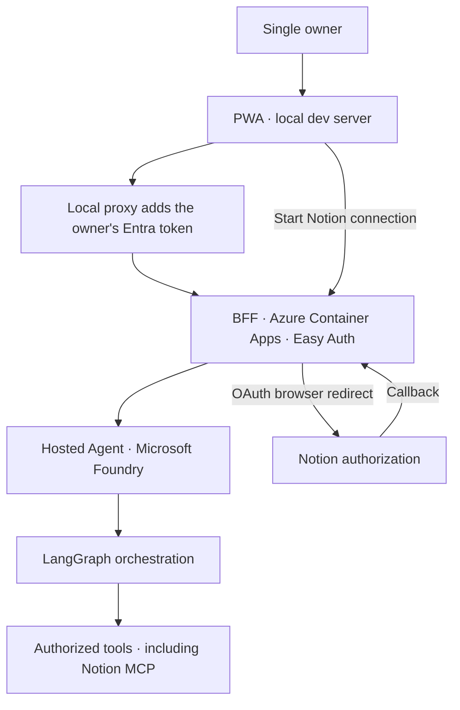

# Savant Azurian 2 — Web App

**A personal, voice-first AI assistant — designed as an installable Progressive Web App (PWA) and hosted on Microsoft Azure.**

**Location:** this app lives in the `pwa/` folder of the [`savant-azurian`](https://github.com/boussecsou/savant-azurian) monorepo (it started in a separate repository).

> **Project status: text vertical slice implemented, end-to-end check pending.** The installable chat app (text chat, *Connect Notion* button, connection state) is in this folder. It runs **locally** and calls the BFF on Azure; it has been verified in a browser against a mocked BFF, but **not** yet against the real BFF and agent (Task 26.4's definition of done). There is no Azure hosting for the app itself (Azure Static Web Apps is unavailable on this subscription; hosting is tracked in Task 40).

## Overview

Savant Azurian 2 is a **single-owner personal AI assistant** built around natural conversation, secure actions, and project-focused work. This folder contains its browser-based interface.

The intended experience combines a clean, focused workspace inspired by **Notion's organization** and **Apple's interface simplicity** with text and, later, voice interaction. Its backend (BFF) and AI runtime live in the rest of this repository.

The web app is designed to be:

- **Personal:** one authenticated owner, without public registration or multi-user account management.
- **Focused:** conversation is the primary workflow; other capabilities remain discoverable without overwhelming the interface.
- **Responsive and accessible:** comfortable on desktop and mobile, with keyboard support, legible typography, and reduced-motion support.
- **Installable:** web manifest, icons, and a small service worker that caches the app shell only (never `/api`).
- **Security-conscious:** no model credentials, Notion OAuth tokens, or privileged Azure secrets in browser code.

## Planned experience

| Area | Experience | Status |
| --- | --- | --- |
| **Voice** | An orb you tap and talk to: live captions, spoken answers read word by word, mute, language (French or English), tool announcements while the agent works | Available |
| **Text chat** | A thread beside the orb, with a composer made for IDs, logs and code (technical mode, `/` commands, copyable ID chips) | Available |
| **Sessions and projects** | Sessions filed in projects (`Main` by default), rename, pin, move, delete with Undo, search, a command palette (Ctrl/⌘+K). Stored in the browser behind a `SessionStore` interface, so the BFF (Cosmos DB) can replace it later | Available, on this device only |
| **Connect Notion** | Connection cards in Settings, with the state the gateway reports | Available |
| **Settings** | Tools and connections, spoken language, read answers aloud, theme, reduce motion, diagnostics | Available |
| **Documents** | Upload and consult project documents with grounded answers | Off (`DOCUMENTS_ENABLED`): needs the RAG |
| **Canvas** | Reports and charts beside the thread | Off (`CANVAS_ENABLED`): needs an artifact channel |
| **Memory** | The agent remembers past sessions and documents of the active project | Planned: Azure AI Search, tasks 37–39 |

**Planned does not mean available.** Parts that need a backend which does not exist yet stay off, so the interface never promises what is not there: projects are a local filing system until the agent receives a `project_id`, approvals stay conversational (the card only types "Yes, go ahead." for you), and only durations really measured in the browser are shown.


## System architecture

The PWA is the **presentation layer**. It does not call Microsoft Foundry or the Notion MCP with privileged browser-held credentials.



The backend is responsible for authenticating the owner, binding a **stable internal user identity on the server**, and forwarding authorized chat requests to the Hosted Agent. Browser-provided user IDs must not be trusted as authorization.

### Frontend-to-backend contract

The following routes belong to the **BFF**, not to this app. The PWA always uses the `/api` prefix, which the local dev proxy forwards to the BFF:

| BFF endpoint | Purpose |
| --- | --- |
| `GET /api/oauth/notion/start` | Begin Notion OAuth authorization (the PWA opens it in a new tab) |
| `GET /api/oauth/notion/status` | `{"connected": bool}`, polled while the consent tab is open |
| `POST /api/chat` | `{message, conversation_id?}` → `{conversation_id, reply}`; the PWA keeps the returned `conversation_id` and sends it with the next message |

Details and the owner-only access model: [`docs/bff-pwa-api.md`](../docs/bff-pwa-api.md).

For backend source code, deployment configuration, and security tests, see the repository root.

## Milestones and evidence

This app follows the Savant Azurian 2 project documentation in Notion:

| Milestone | Definition of done | Status |
| --- | --- | --- |
| [Task 26.3 — PWA-facing BFF routes](https://app.notion.com/p/3f1eba09656f81eab6d2cc086520e626) | Owner-authenticated chat/OAuth routes and consistent server-side identity | Routes merged; Entra owner access pending (Task 26.35) |
| [Task 26.4 — Text PWA vertical slice](https://app.notion.com/p/3f1eba09656f8196841df3cde6428553) | From the local PWA against the Azure BFF, connect Notion and retrieve real tasks through the BFF and agent | App implemented; end-to-end check pending |
| [Task 40 — Complete PWA](https://app.notion.com/p/3d1eba09656f817ca3b3f64c6e55dc9e) | Extend the same app to voice, projects, documents, and robust connection states | Not started |

The first PWA milestone requires an **actual** end-to-end check against the Azure backend; a mockup or a successful static website build is not equivalent to a verified Notion integration.

## Stack

**React 19 + Vite + TypeScript**, no UI library and no animation library: motion is plain CSS. The interface is a port of the UI lab (`local_labo/`) described by its integration report and by SDD-005.

```text
```text
dev/
  token.ts, plugin.ts    # local dev proxy: fetches the owner's Entra token with `az` and adds it to /api calls
src/
  main.tsx, App.tsx      # entry point; App wires the workspace, the BFF stream and the voice loop
  api.ts                 # calls to the BFF and error mapping
  state/                 # workspace (projects, sessions: a pure reducer), SessionStore (browser storage and
                         # migration of the old chat), grouping, ids, transcript, useWorkspace
  chat.ts                # message types, and the reader of the old one-conversation storage
  orb/                   # orb palettes and maths (pure), drawn by components/stage/OrbCanvas.tsx
  hooks/                 # presence, media queries, online, motion, toasts
  voice.ts, useVoice.ts, narration.ts   # speech loop, captions, fixed tool announcements
  markdown.tsx           # tiny safe Markdown subset for replies (no HTML injection), with copyable ID chips
  connections.ts, approval.ts, palette.ts, composerKeys.ts, flags.ts   # small pure rules, all tested
  useNotion.ts           # connection state and polling
  components/            # shell/ (AppShell, TopBar, Banner, Splash), rail/ (project switcher, sessions), stage/, dock/, overlays/, SettingsDrawer (a centred panel)
  boot.ts, viewMode.ts   # start-up screen timeline, chat-only preference (pure, tested)
public/
  manifest.webmanifest, sw.js, icons/
```

## Local development

Requires Node.js 22.12 or later.

```bash
cd pwa
npm ci
npm test           # unit tests (UI helpers and the dev token provider)
npm run build      # type-check, then build to dist/
npm run dev        # dev server on http://localhost:5173
```

### Talking to the Azure BFF

The BFF sits behind Container Apps authentication (Easy Auth) with Microsoft Entra ID. The dev server's proxy adds **your** Entra token to every `/api` request, so no token ever reaches the browser. Create `pwa/.env.local` (git-ignored):

```dotenv
# Public URL of the BFF Container App
SA2_BFF_URL=https://<bff>.<region>.azurecontainerapps.io
# Application ID URI of the BFF's Entra app registration (the token audience)
SA2_BFF_APP_ID_URI=api://<application-id>
```

Then sign in once with the Azure CLI (`az login`) and run `npm run dev`. The proxy calls `az account get-access-token --resource <SA2_BFF_APP_ID_URI>` and reuses the token until shortly before it expires (about one hour). If the CLI cannot return a token, `/api` answers 401 and the UI asks you to run `az login`.

- Without `SA2_BFF_URL`, `/api` is not proxied (UI only).
- Without `SA2_BFF_APP_ID_URI`, requests are proxied without a token (useful against a BFF started locally on `http://localhost:8090`).
- The Notion consent callback (`/oauth/notion/callback`) is not proxied: Notion redirects the browser straight to the BFF's public URL.
- Azure-side setup (app registration, Easy Auth, user assignment, BFF variables) is documented in [`docs/bff-pwa-api.md`](../docs/bff-pwa-api.md) and tracked in Task 26.35.

## Hosting

The app is **not hosted in Azure**: it runs on the owner's machine. Azure Static Web Apps is unavailable on the Azure for Students subscription (region policy), and the hosting decision belongs to Task 40. Until then, `npm run build` only validates that the app compiles; CI runs the tests and the build from the repository's CI workflow.

When hosting is decided, response headers (a strict Content-Security-Policy such as `default-src 'self'; script-src 'self'; style-src 'self'; connect-src 'self'; frame-ancestors 'none'`, `X-Content-Type-Options`, `Referrer-Policy`) must be configured by the host: the former `staticwebapp.config.json` that carried them was removed.

## Security boundaries

- **Authenticate at the edge and at the BFF:** Easy Auth validates the owner's Entra token (with *User assignment required*), and the BFF checks the caller's Entra object ID again. A fixed owner key and CORS restrictions alone are not authentication.
- **Do not embed secrets:** never place API keys, OAuth tokens, private configuration, or service credentials in frontend source or environment variables exposed to the browser.
- **Call the BFF:** the PWA should not bypass server-side access control by calling privileged agent/tool endpoints directly.
- **Preserve consent:** sensitive Notion mutations need an explicit, operation-scoped approval flow enforced by the backend.
- **Secure session handling:** browser authentication/session behavior and allowed origins must be defined and tested with the BFF.
- **Treat displayed data as untrusted:** replies are rendered as React nodes from a small Markdown subset, never as HTML, and only `http(s)` links are made clickable. Keep the app free of inline script and style so a strict Content-Security-Policy can be applied by whichever host is chosen.

## Design principles

The visual direction aims for **Apple-like calm and precision** with **Notion-like information organization**:

- Quiet surfaces, subtle separators, generous spacing, and a restrained accent.
- Typography and content hierarchy before decorative cards or dashboards.
- Voice-first: the orb at the centre, sessions and projects on the left, the thread on the right. Connections live in Settings only.
- Deliberate, short interactions rather than animation for its own sake.
- Responsive behavior, accessible focus indicators, touch-friendly controls, and reduced-motion support.

Motion follows Emil Kowalski's design-engineering rules: strong custom easing curves, UI transitions under 300 ms, only `transform` and `opacity`, a `scale(0.97)` press on every tappable element, near-imperceptible message entrances, and a gentler variant when motion is reduced (the OS setting, or *Reduce motion* in Settings: fades stay, movement goes). Light and dark themes follow the system setting.

## Project references

- [`savant-azurian` — AI runtime, BFF and this app](https://github.com/boussecsou/savant-azurian)
- [Savant Azurian 2 — Notion project](https://app.notion.com/p/3b8eba09656f8059a384f1da1d984f9a)
- [SDD-002 — Architecture & Azure Infrastructure](https://app.notion.com/p/3bfeba09656f8167bc3cf32a3b5d59f8)
- [Task 26.4 — Text PWA](https://app.notion.com/p/3f1eba09656f8196841df3cde6428553)

## License

See [LICENSE](LICENSE) for the repository's license terms.
